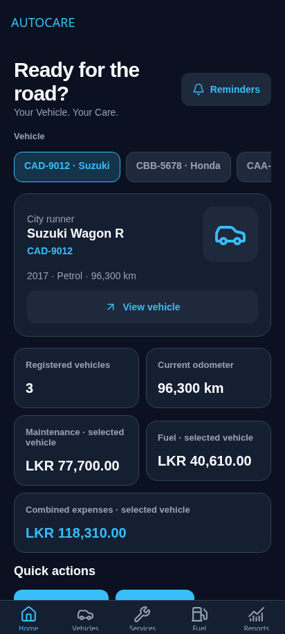
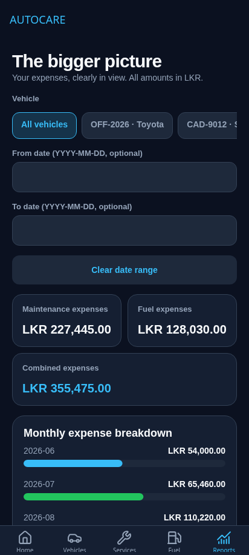

# AutoCare

### Offline Vehicle Maintenance Tracker

*Your Vehicle. Your Care.*

AutoCare keeps vehicle maintenance records, fuel purchases, and reminders in one place. It is an Android app built with React Native and Expo for an individual university assignment.

The app stores everything locally in SQLite, so there is no account to create or server to connect to. Costs are shown in Sri Lankan rupees (LKR). The interface uses a dark theme called Midnight Drive.

## What you can do

- Keep track of multiple vehicles, including their registration, mileage, and photos.
- Record services with the date, category, workshop, cost, and any notes.
- Log fuel purchases and see spending, litres purchased, and fuel efficiency where enough information is available.
- Search records and filter them by vehicle or service category.
- View monthly expenses and compare spending across vehicles.
- Set maintenance reminders by date, mileage, or both, then mark them as completed.

The Home tab brings together the selected vehicle's mileage, expenses, recent services, and reminders. The other four tabs are Vehicles, Services, Fuel, and Reports.

## Screenshots

These screenshots were taken from the browser preview at a mobile screen size. They are not Android device captures.

| Home | Reports |
| --- | --- |
|  |  |

## Built with

- React Native 0.88, React 19.3, and Expo SDK 58
- JavaScript and JSX
- Expo Router for navigation
- expo-sqlite for local storage
- React Context for shared application data
- React Native StyleSheet, Lucide icons, and react-native-svg
- expo-image-picker and expo-file-system for vehicle photos
- Jest and React Native Testing Library for tests

## Getting started

You will need Node.js 24 or later, npm, and an Android phone with a version of Expo Go that supports SDK 58. A configured Android emulator also works.

```bash
git clone https://github.com/nethsara-rahiru/AutoCare.git
cd AutoCare
npm install
npx expo start
```

Scan the QR code using Expo Go. Keep your phone and development computer on a network where they can reach each other.

For an Android emulator:

```bash
npm run android
```

Use `npm ci` instead of `npm install` if you want to install the exact versions in the lockfile.

### Browser preview

```bash
npm run web
```

Use a recent version of Chromium. The browser preview has its own database, separate from the Android app.

### Android release build

With the Android SDK, JDK 17 or later, and a device or emulator configured:

```bash
npx expo run:android --variant release
```

A release build includes the JavaScript bundle, which is needed to test starting the app without a network connection. Expo Go needs to download the development bundle from Metro first.

## Sample data

On the first launch, AutoCare adds a fictional Sri Lankan dataset:

- 3 vehicles: a Toyota Prius, Honda Civic, and Suzuki Wagon R
- 12 service records
- 15 fuel records
- 6 maintenance reminders

You can edit or delete these records just like your own. They are only added once, so deleting a sample vehicle will not bring it back on the next launch.

## Local storage

The database is named `autocare.db`. It contains four main tables:

| Table | Stores |
| --- | --- |
| `vehicles` | Vehicle details, registration numbers, current mileage, and photo paths |
| `services` | Service dates, categories, mileage, costs, workshops, and notes |
| `fuel_logs` | Fill-up dates, odometer readings, litres, costs, and full-tank status |
| `reminders` | Maintenance titles, date or mileage targets, notes, and completion status |

A small `app_meta` table records whether the sample data has already been added. Schema changes use versioned migrations to preserve existing records.

Deleting a vehicle also deletes its services, fuel logs, and reminders after confirmation. Selected photos are copied into the app's document directory. Clearing app storage or uninstalling the app removes the saved data; there is currently no backup or sync option.

See the [database schema](src/database/schema.js) and [architecture notes](docs/ARCHITECTURE.md) for more detail.

## A few calculation rules

Fuel efficiency uses two consecutive full-tank records for the same vehicle. The distance between their odometer readings is divided by the litres purchased at the later fill-up. A partial fill breaks that interval. If there is not enough reliable data, the app explains why it cannot show an efficiency value.

Service and fuel records can increase a vehicle's current mileage, but never reduce it. Editing a vehicle also prevents setting mileage below an existing record.

Reminders become due when their date is today or their mileage target is reached. They become overdue when either target has been passed. A completed reminder stays completed regardless of its targets.

## Tests and checks

```bash
npm test
npm test -- --coverage
npm run lint
npm run format:check
npm run check
npx expo-doctor
npx expo export --platform android
```

The tests cover validation, database operations, search and filtering, calculations, reminder states, related-record deletion, and persistence after reopening the database. Database integration tests use Node's built-in SQLite engine.

`npm run lint` is a project-specific source check: it parses the application files, checks local imports, and looks for runtime network dependencies. GitHub Actions also runs the tests, formatting checks, dependency checks, and Android JavaScript export.

There is an optional browser smoke test. It requires Python Playwright and Chromium, with the web preview running on port 8081:

```bash
# Terminal 1
npm run web -- --port 8081

# Terminal 2
python scripts/browser-smoke.py
```

Set `CHROMIUM_PATH` if Chromium is installed somewhere other than `/usr/bin/chromium`.

## Project layout

```text
app/                 Screens and Expo Router layouts
src/components/      Shared controls, forms, cards, and charts
src/database/        SQLite setup, migrations, sample data, and repositories
src/hooks/           Shared state and data refresh
src/theme/           Colours and spacing
src/constants/       Service categories and fuel types
src/utils/           Validation, formatting, and calculations
__tests__/           Unit, component, and database tests
scripts/             Source checks and browser smoke test
docs/                Architecture, screenshots, and manual test checklist
```

## Current limitations

Reminders are shown inside the app; they do not send device notifications. Dates are entered in `YYYY-MM-DD` format. Replacing or removing a photo may leave an unused image file in app storage.

Automated tests and browser offline checks have passed. Android device testing and a native release build still need to be completed, including photo permissions, keyboard behaviour, and restarting in airplane mode. The Android JavaScript export checks the bundle, but does not replace those device tests.

The [manual Android checklist](docs/MANUAL_QA.md) covers the remaining checks. Detailed test results are recorded in the [delivery notes](docs/DELIVERY.md).
